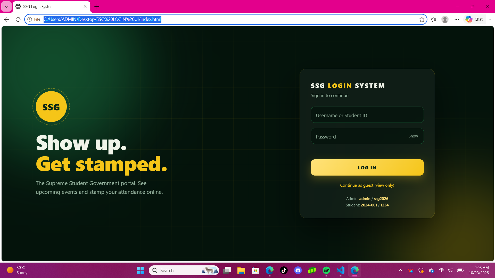
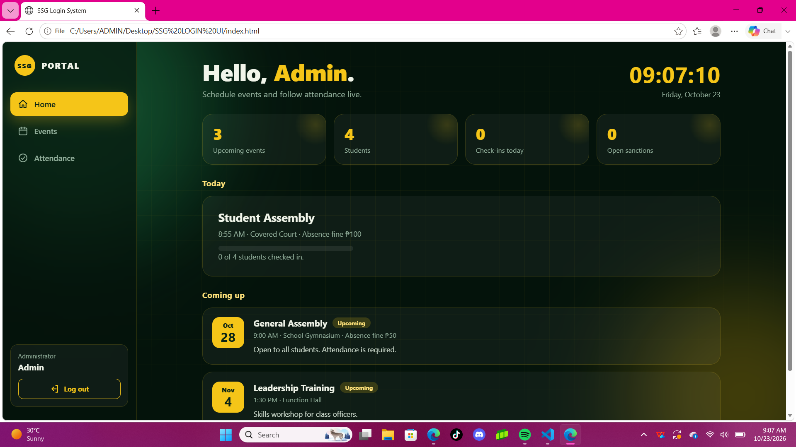
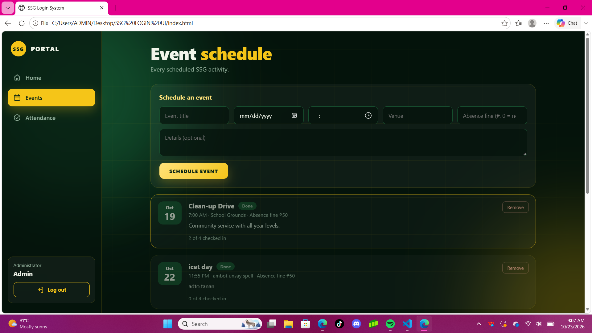
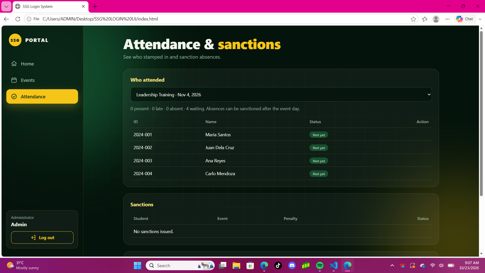
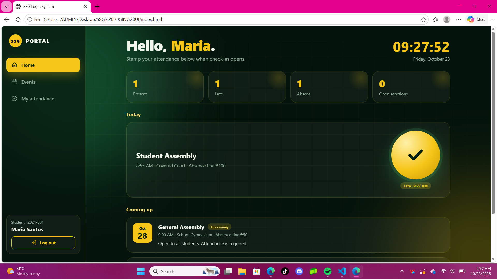
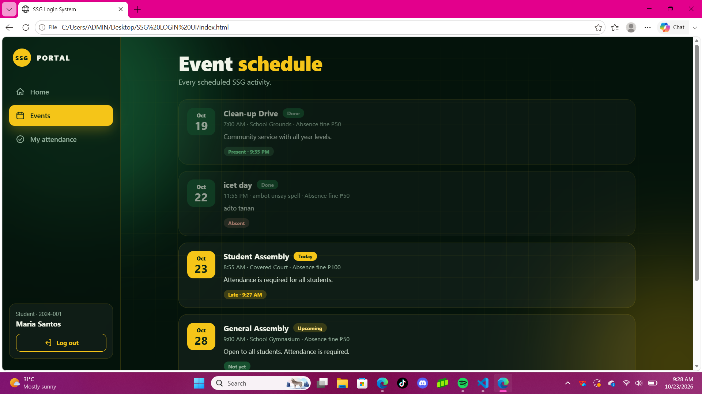
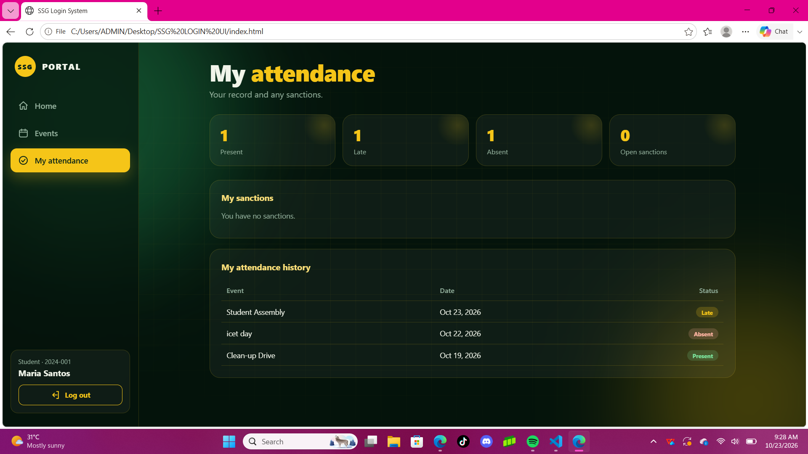
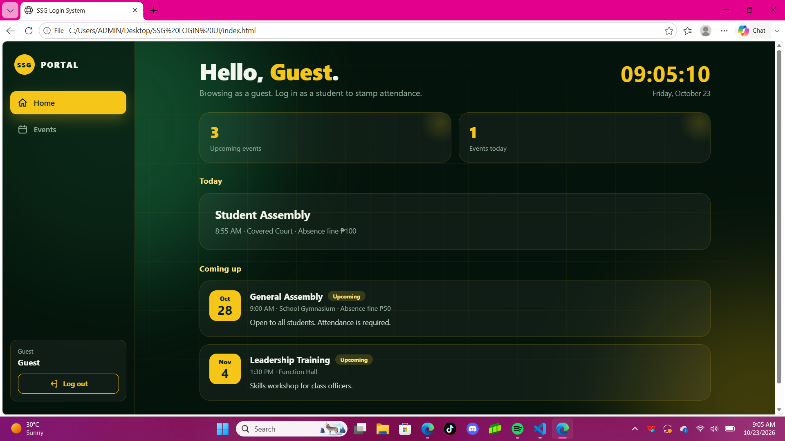
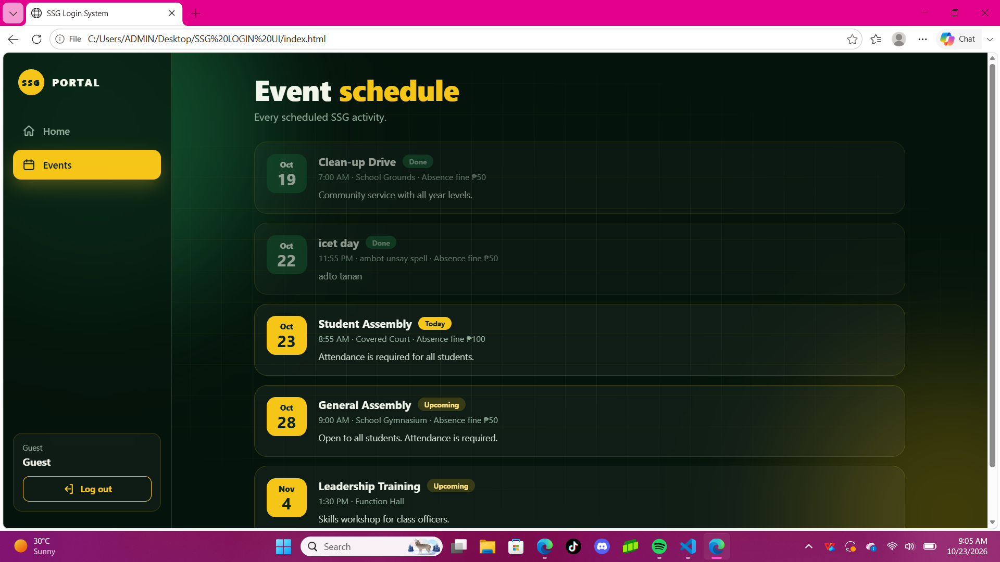

# SSG Login System

A login and portal system for the Supreme Student Government (SSG). Students can see events, check their attendance, and view how SSG funds are used.

## Features

- Animated login screen with show/hide password
- Three access levels: Admin, Student, and Guest (view only)
- **Events:** admins schedule events, students view them
- **Attendance:** students stamp their own attendance, and admins can mark attendance and issue sanctions

## Screenshots

### Login

### Admin View

### Student View

### Guest View

## How to Run

1. Download `index.html`
2. Open it in any web browser

No installation needed.

## Demo Accounts

| Role | Username | Password |
|---|---|---|
| Admin | admin | ssg2026 |
| Student | 2024-001 | 1234 |

These are demo logins for the class project only.

## Built With

- HTML

## Group 4 Members

- Cj Mantuon
- Kieth Ryan Guarino
- Janice I. Masunong
- Stevin Tancio
- Mesion Abdon
- Jude Andrew Donaire

## Note

Data is saved in the browser only (localStorage). This is a school project, not a production system.
